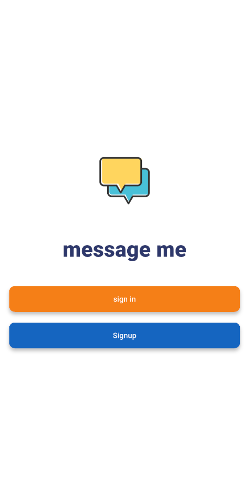
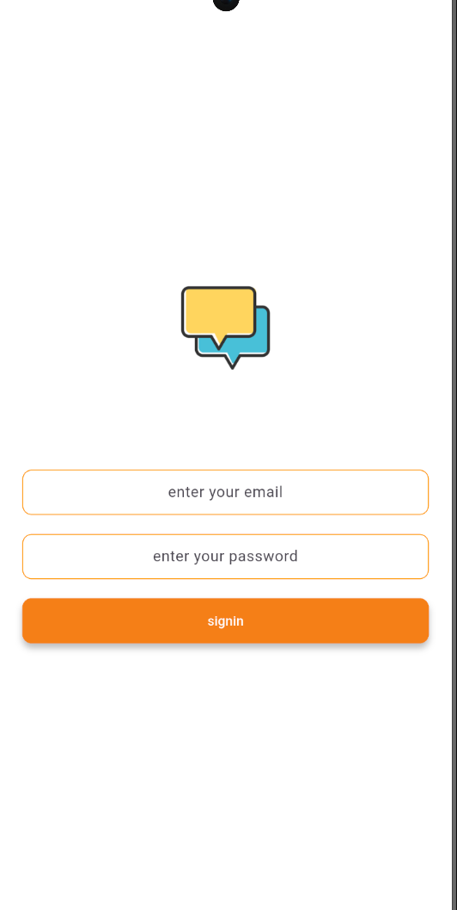
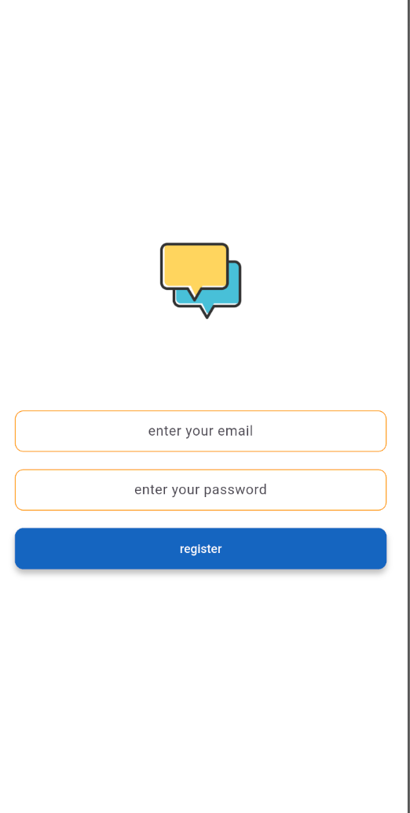
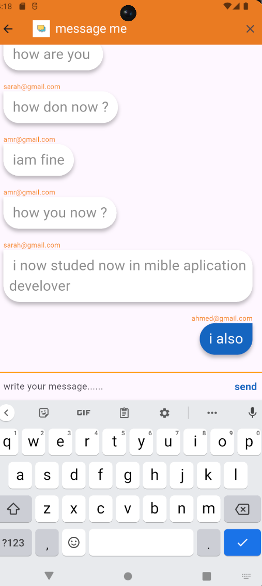

# 💬 Real-Time Chat Application

A feature-rich Flutter mobile application designed for real-time messaging, secure user authentication, and seamless communication. Powered by Firebase backend services.

---

## 📱 App Screenshots
Homepage | SignIn Screen |
| :---: | :---: |
|  |  |

| Signup Screen | Message Screen |
| :---: | :---: |
|  |  |

---

## 📌 Features

- **User Authentication:** Secure Sign Up, Login, and Logout using Firebase Authentication.
- **Real-Time Messaging:** Instant message delivery and syncing via Cloud Firestore streams.
- **Chat Conversations:** Smooth user-to-user private messaging interface.
- **User Profiles & Status:** Customized profile management and status display.
- **Media Sharing:** Send images and attachments directly within the chat.

---

## 🔗 Backend Services

This application uses Google Firebase for serverless backend operations:
- **Firebase Authentication:** Handles user identity and session management.
- **Cloud Firestore:** Real-time NoSQL database for messages and conversation updates.
- **Firebase Storage:** File storage for media attachments and user avatars.
